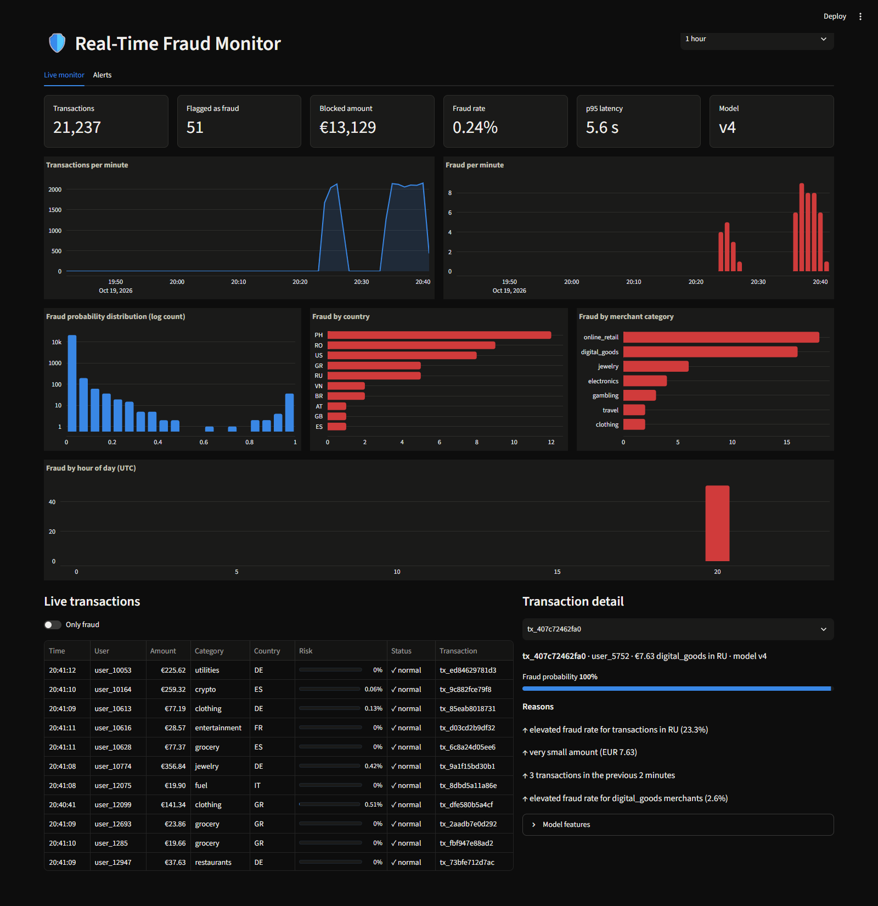
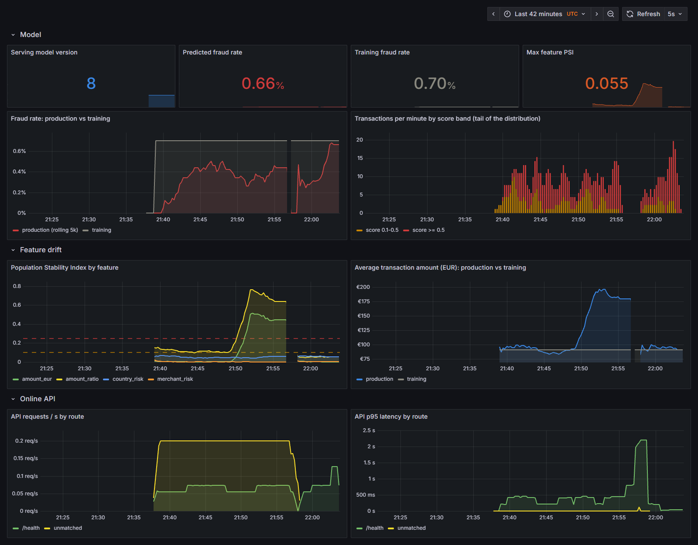

# Real-Time Fraud Detection Platform

Production-style streaming data platform for detecting fraudulent card
transactions in real time: event ingestion with Kafka, stateful feature
engineering with Spark Structured Streaming, ML scoring with a registered
model, and serving, monitoring and retraining around it.

> 🚧 Work in progress — the platform is built phase by phase (see the roadmap).

## Target architecture

```text
Transaction producer ─► Kafka (transactions) ─► Spark Structured Streaming
                                                  │  validation, features
                                   ┌──────────────┴──────────────┐
                                   ▼                             ▼
                            Data lake (Parquet)          Fraud scoring (MLflow model)
                                                                 │
                                                  Kafka (fraud_predictions)
                                                       │                │
                                                   PostgreSQL        Alerts
                                                       │
                                                   Dashboard

Airflow ► retraining · MLflow ► experiments + registry · Prometheus/Grafana ► monitoring
```

## Run the whole platform

```bash
docker compose up -d --build          # ~5 min on first build; trains a first model if the registry is empty
python producer/producer.py --rate 30 # or: docker compose --profile demo up -d producer
python scripts/smoke_test.py          # health checks + end-to-end verification
```

| Service | URL | Notes |
| --- | --- | --- |
| Fraud dashboard (Streamlit) | http://localhost:8501 | live monitor, alerts, data quality |
| Prediction API (FastAPI) | http://localhost:8000/docs | `POST /predict`, alerts, stats |
| Grafana | http://localhost:3001 | streaming + model/drift dashboards (admin / admin) |
| Prometheus | http://localhost:9090 | metrics and alert rules |
| MLflow | http://localhost:5000 | experiments + model registry |
| Airflow | http://localhost:8080 | retraining DAG (admin / admin) |
| Spark UI | http://localhost:4040 | structured streaming queries |
| Kafka | localhost:9094 | topics `transactions`, `fraud_predictions`, `fraud_alerts`, `dead_letter_transactions` |
| PostgreSQL | localhost:5436 | db/user `fraud` |

On a fresh checkout `model-bootstrap` generates the labelled dataset, trains
XGBoost and registers it as the `champion` before Spark and the API start.
Credentials are local-development defaults.

## Develop locally

```bash
python -m venv .venv && . .venv/bin/activate      # Windows: .venv\Scripts\activate
pip install -r requirements-dev.txt

python producer/transaction_generator.py --rate 20   # continuous JSON transactions
python -m ml.dataset                                  # labelled history -> data/raw/transactions.parquet
python -m ml.eda                                      # summary + charts in docs/images/
python -m ml.train                                    # compare LR / RF / XGBoost / LightGBM, save XGBoost
python -m ml.predict                                  # score recent transactions with the saved model
python -m ml.public_benchmark                         # same model families on the public ULB dataset
```

### Experiment tracking (MLflow)

```bash
docker compose up -d mlflow                          # http://localhost:5000
export MLFLOW_TRACKING_URI=http://localhost:5000     # PowerShell: $env:MLFLOW_TRACKING_URI="http://localhost:5000"
python -m ml.train                                   # logged + registered as fraud-detector v1 ("champion")
python -m ml.train --sweep                           # 12-run XGBoost sweep, best registered as a new version
```

Each run records hyper-parameters, test metrics (ROC-AUC, PR-AUC, precision,
recall, F1, threshold), the comparison models' metrics, a precision-recall
plot, the confusion matrix and the portable serving artefacts. The sweep picks
its winner on **validation** PR-AUC so the test split stays untouched. Serving
components load whichever registry version carries the `champion` alias.


### Real-time scoring

```text
Kafka ─► Spark (validate ─► features ─► XGBoost champion) ─► Kafka fraud_predictions
                                                           └► data/lake/predictions
```

```bash
python producer/consumer.py --topic fraud_predictions -v
```

```json
{"transaction_id": "tx_5456d1f41635", "user_id": "user_11497", "amount_eur": 642.83,
 "merchant_category": "crypto", "country": "GR", "event_time": "2026-10-19T20:11:04.804Z",
 "fraud_probability": 0.027257, "prediction": "LEGIT", "model_version": "4",
 "risk_factors": ["new device (device_96084ae47b)", "first transaction from BR", "very small amount (EUR 3.24)"],
 "scored_at": "2026-10-19T20:11:06.517Z", "features": {"tx_count_2m": 0.0, "amount_ratio": 0.008, ...}}
```

The driver resolves the registry version with the `champion` alias and ships
the raw artefacts to executors as a **broadcast variable**; executors score
with `mapInPandas`, caching the deserialized booster per version. Every
micro-batch the driver re-checks the registry (at most once a minute), so
promoting a new version in MLflow hot-swaps the model without restarting the
stream. Each prediction is explained with TreeSHAP-based **risk factors**
([docs/explainability.md](docs/explainability.md)). Lake writes go to a batch-specific directory overwritten on replay,
which keeps them idempotent under Spark's at-least-once `foreachBatch`.

### Serving store and API

PostgreSQL (`localhost:5436`, schema in
[storage/schema.sql](storage/schema.sql)) holds
what the dashboard and API query interactively: `transactions`,
`fraud_predictions` (score, model version, risk factors, SHAP values,
features, latency), `fraud_alerts`, `transaction_stats_minute` and
`model_metadata`. Spark writes them from `foreachPartition` with
`ON CONFLICT` upserts, so replayed micro-batches never duplicate rows.
Historical data stays in the Parquet lake for analytics and retraining.

The FastAPI service (`http://localhost:8000/docs`) adds synchronous scoring for
authorization flows: `POST /predict` rebuilds the card holder's behavioural
state from PostgreSQL with the same `UserState` class and returns the score
with its explanation.

```bash
curl -X POST localhost:8000/predict -H 'content-type: application/json' -d '{
  "user_id": "user_5326", "merchant_id": "merchant_9", "merchant_category": "jewelry",
  "amount": 2400, "currency": "EUR", "country": "NG", "device_id": "device_new"}'
# {"fraud_probability": 0.9997, "prediction": "FRAUD", "model_version": "4",
#  "risk_factors": ["new device (device_new)", "elevated fraud rate for transactions in NG (14.3%)",
#                   "high amount (EUR 2,400)", ...], "features": {"amount_ratio": 178.6, ...}}
```

Other endpoints: `GET /predictions`, `GET /predictions/{id}`, `GET /alerts`,
`PATCH /alerts/{id}` (analyst feedback: confirmed / dismissed),
`GET /stats/summary`, `GET /health`.

### Fraud dashboard

```bash
docker compose up -d --build dashboard              # http://localhost:8501
```



KPIs, transactions and fraud per minute, the score distribution, fraud by
country / merchant category / hour, a live transaction table and a detail
panel with the model's reasons for each flagged transaction. An **Alerts** tab
lets an analyst confirm or dismiss alerts — the feedback that becomes labels
for retraining. The page refreshes itself every 5 seconds (`st.fragment`).

### Automated retraining (Airflow)

```bash
docker compose up -d --build airflow                 # http://localhost:8080  (admin / admin)
docker compose exec airflow airflow dags trigger retrain_fraud_model
```

`retrain_fraud_model` runs weekly: validate data -> extract -> features ->
train (registered in MLflow) -> evaluate candidate **and** champion on the same
newest data -> promote only if the candidate wins by a margin. Promotion moves
the MLflow `champion` alias, which the stream and API hot-swap. Airflow
orchestrates batch work only; it never sits in the streaming path. Details:
[docs/retraining.md](docs/retraining.md).

### Data quality and dead-letter queue

Invalid records (malformed JSON, missing ids, non-positive or non-numeric
amounts, unsupported currencies, invalid countries, future timestamps),
duplicate transaction ids and events beyond the allowed lateness are routed
to the `dead_letter_transactions` topic and table with their rejection
reasons; the stream keeps running. The producer can inject all of them:
`--invalid-rate 0.01 --duplicate-rate 0.01`. See
[docs/data-quality.md](docs/data-quality.md).

### Monitoring (Prometheus + Grafana)

```bash
docker compose up -d prometheus grafana kafka-exporter   # Grafana http://localhost:3001, Prometheus :9090
python producer/producer.py --rate 30 --metrics-port 8001 --amount-drift 2.0   # drift drill
```

Infrastructure: throughput, Kafka lag, end-to-end and inference latency,
batch duration, state size, watermark drops, dead letters, CPU/memory. ML:
score distribution, fraud rate vs training, serving version and **feature
drift (PSI)** against baselines stored with the model. Six alert rules
(lag, latency, stalled scoring, DLQ rate, drift, anomalous fraud rate). See
[docs/monitoring.md](docs/monitoring.md).



### Kafka ingestion

```bash
docker compose up -d kafka kafka-init                # KRaft broker on localhost:9094 + topics
python producer/consumer.py                          # terminal B: received transaction tx_...
python producer/producer.py --rate 20                # terminal A: produced transaction tx_...
```

Topics: `transactions` (6 partitions, keyed by `user_id` so each card's events
stay ordered) and `fraud_predictions`. The event contract is
[schemas/transaction.v1.json](schemas/transaction.v1.json); messages carry a
`schema_version` header. The producer uses `acks=all` with idempotence, so
broker retries never create duplicates.

### Spark Structured Streaming

```bash
docker compose up -d --build spark                   # Spark UI: http://localhost:4040
python producer/producer.py --rate 30 --quiet
docker compose logs -f spark                         # running per-category statistics
```

The job (`streaming/fraud_stream.py`) deserializes each Kafka record against an
**explicit schema** (`streaming/schemas.py`), attaches the list of violated
validation rules, drops invalid records, normalises amounts to EUR and appends
every valid transaction to the Parquet data lake (`data/lake/transactions`,
partitioned by event date). State lives in RocksDB-backed state stores with
checkpoints, so the job resumes exactly where it stopped after a restart.

Per-user **behavioural features** (velocity over 2 min/5 min/1 h/24 h, amount
vs. the user's 24 h average, new country, new device, merchant/country
diversity, time since the last transaction) are computed with
`applyInPandasWithState`, using the same `UserState` class that builds the
training set — see [docs/features.md](docs/features.md). They lift XGBoost
from 0.50 to **0.79 PR-AUC**.

**Event-time processing and watermarking are used to handle late-arriving
transactions while limiting streaming state growth.** Features and 1-minute
windows are computed on the transaction's own timestamp, a 2-minute watermark
bounds state (per-user state expires through an event-time timeout), and
events later than the allowed lateness go to a side output rather than being
dropped silently — see [docs/event-time.md](docs/event-time.md). The producer
can inject late and out-of-order events: `--late-rate 0.05 --very-late-rate 0.005`.

See [docs/eda.md](docs/eda.md) for the dataset design and exploratory analysis and
[docs/model-comparison.md](docs/model-comparison.md) for the baseline models.

## Repository layout

| Path | Purpose |
| --- | --- |
| `producer/` | Synthetic transaction generator and Kafka producer |
| `streaming/` | Spark Structured Streaming job, schemas, streaming features |
| `ml/` | Feature pipeline, training, evaluation, prediction |
| `api/` | Prediction serving API |
| `dashboard/` | Real-time fraud monitor |
| `airflow/dags/` | Scheduled retraining / batch pipelines |
| `monitoring/` | Prometheus and Grafana configuration |
| `infrastructure/` | Terraform for the cloud deployment |
| `tests/` | Unit and integration tests |
| `docs/` | Architecture and design notes |

## Roadmap

- [x] Phase 1 — Transaction generator and dataset
- [x] Phase 2 — Baseline fraud model
- [x] Phase 3 — MLflow tracking and registry
- [x] Phase 4 — Kafka ingestion
- [x] Phase 5 — Spark Structured Streaming
- [x] Phase 6 — Behavioural streaming features
- [x] Phase 7 — Event time and watermarking
- [x] Phase 8 — Real-time ML scoring
- [x] Phase 9 — Explainability
- [x] Phase 10 — PostgreSQL serving store
- [x] Phase 11 — Fraud dashboard
- [x] Phase 12 — Airflow retraining
- [x] Phase 13 — Data quality and dead-letter queue
- [x] Phase 14 — Monitoring (Prometheus/Grafana)
- [x] Phase 15 — Full Docker Compose stack
- [ ] Phase 16 — Tests
- [ ] Phase 17 — CI/CD
- [ ] Phase 18 — Cloud deployment
- [ ] Phase 19 — Terraform
- [ ] Phase 20 — Documentation
