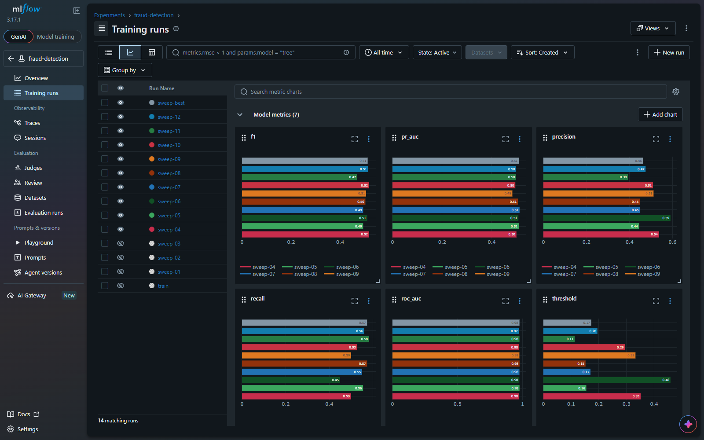

# Real-Time Fraud Detection Platform

Production-style streaming data platform for detecting fraudulent card
transactions in real time: event ingestion with Kafka, stateful feature
engineering with Spark Structured Streaming, ML scoring with a registered
model, and serving, monitoring and retraining around it.

> 🚧 Work in progress — the platform is built phase by phase (see the roadmap).

## Target architecture

```text
Transaction producer ─► Kafka (transactions) ─► Spark Structured Streaming
                                                  │  validation, features
                                   ┌──────────────┴──────────────┐
                                   ▼                             ▼
                            Data lake (Parquet)          Fraud scoring (MLflow model)
                                                                 │
                                                  Kafka (fraud_predictions)
                                                       │                │
                                                   PostgreSQL        Alerts
                                                       │
                                                   Dashboard

Airflow ► retraining · MLflow ► experiments + registry · Prometheus/Grafana ► monitoring
```

## Quickstart

```bash
python -m venv .venv && . .venv/bin/activate      # Windows: .venv\Scripts\activate
pip install -r requirements-dev.txt

python producer/transaction_generator.py --rate 20   # continuous JSON transactions
python -m ml.dataset                                  # labelled history -> data/raw/transactions.parquet
python -m ml.eda                                      # summary + charts in docs/images/
python -m ml.train                                    # compare LR / RF / XGBoost / LightGBM, save XGBoost
python -m ml.predict                                  # score recent transactions with the saved model
python -m ml.public_benchmark                         # same model families on the public ULB dataset
```

### Experiment tracking (MLflow)

```bash
docker compose up -d mlflow                          # http://localhost:5000
export MLFLOW_TRACKING_URI=http://localhost:5000     # PowerShell: $env:MLFLOW_TRACKING_URI="http://localhost:5000"
python -m ml.train                                   # logged + registered as fraud-detector v1 ("champion")
python -m ml.train --sweep                           # 12-run XGBoost sweep, best registered as a new version
```

Each run records hyper-parameters, test metrics (ROC-AUC, PR-AUC, precision,
recall, F1, threshold), the comparison models' metrics, a precision-recall
plot, the confusion matrix and the portable serving artefacts. The sweep picks
its winner on **validation** PR-AUC so the test split stays untouched. Serving
components load whichever registry version carries the `champion` alias.



### Kafka ingestion

```bash
docker compose up -d kafka kafka-init                # KRaft broker on localhost:9094 + topics
python producer/consumer.py                          # terminal B: received transaction tx_...
python producer/producer.py --rate 20                # terminal A: produced transaction tx_...
```

Topics: `transactions` (6 partitions, keyed by `user_id` so each card's events
stay ordered) and `fraud_predictions`. The event contract is
[schemas/transaction.v1.json](schemas/transaction.v1.json); messages carry a
`schema_version` header. The producer uses `acks=all` with idempotence, so
broker retries never create duplicates.

### Spark Structured Streaming

```bash
docker compose up -d --build spark                   # Spark UI: http://localhost:4040
python producer/producer.py --rate 30 --quiet
docker compose logs -f spark                         # running per-category statistics
```

The job (`streaming/fraud_stream.py`) deserializes each Kafka record against an
**explicit schema** (`streaming/schemas.py`), attaches the list of violated
validation rules, drops invalid records, normalises amounts to EUR and appends
every valid transaction to the Parquet data lake (`data/lake/transactions`,
partitioned by event date). State lives in RocksDB-backed state stores with
checkpoints, so the job resumes exactly where it stopped after a restart.

Per-user **behavioural features** (velocity over 2 min/5 min/1 h/24 h, amount
vs. the user's 24 h average, new country, new device, merchant/country
diversity, time since the last transaction) are computed with
`applyInPandasWithState`, using the same `UserState` class that builds the
training set — see [docs/features.md](docs/features.md). They lift XGBoost
from 0.50 to **0.79 PR-AUC**.

See [docs/eda.md](docs/eda.md) for the dataset design and exploratory analysis and
[docs/model-comparison.md](docs/model-comparison.md) for the baseline models.

## Repository layout

| Path | Purpose |
| --- | --- |
| `producer/` | Synthetic transaction generator and Kafka producer |
| `streaming/` | Spark Structured Streaming job, schemas, streaming features |
| `ml/` | Feature pipeline, training, evaluation, prediction |
| `api/` | Prediction serving API |
| `dashboard/` | Real-time fraud monitor |
| `airflow/dags/` | Scheduled retraining / batch pipelines |
| `monitoring/` | Prometheus and Grafana configuration |
| `infrastructure/` | Terraform for the cloud deployment |
| `tests/` | Unit and integration tests |
| `docs/` | Architecture and design notes |

## Roadmap

- [x] Phase 1 — Transaction generator and dataset
- [x] Phase 2 — Baseline fraud model
- [x] Phase 3 — MLflow tracking and registry
- [x] Phase 4 — Kafka ingestion
- [x] Phase 5 — Spark Structured Streaming
- [x] Phase 6 — Behavioural streaming features
- [ ] Phase 7 — Event time and watermarking
- [ ] Phase 8 — Real-time ML scoring
- [ ] Phase 9 — Explainability
- [ ] Phase 10 — PostgreSQL serving store
- [ ] Phase 11 — Fraud dashboard
- [ ] Phase 12 — Airflow retraining
- [ ] Phase 13 — Data quality and dead-letter queue
- [ ] Phase 14 — Monitoring (Prometheus/Grafana)
- [ ] Phase 15 — Full Docker Compose stack
- [ ] Phase 16 — Tests
- [ ] Phase 17 — CI/CD
- [ ] Phase 18 — Cloud deployment
- [ ] Phase 19 — Terraform
- [ ] Phase 20 — Documentation
