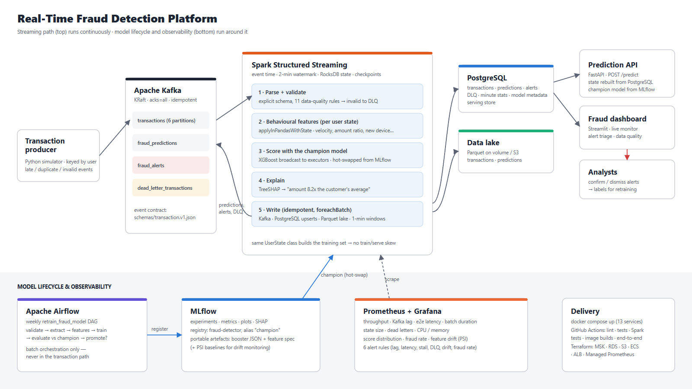

# Real-Time Fraud Detection Platform

[](https://github.com/kgiannopoulou/real-time-fraud-detection-platform/actions/workflows/ci.yml)

Production-style streaming data platform for detecting fraudulent card
transactions in real time. Transactions flow through **Kafka** into **Spark
Structured Streaming**, which validates them, computes stateful per-customer
behavioural features in event time, scores them with an **XGBoost** model
served from the **MLflow** registry and explains every decision. Predictions
land in Kafka, **PostgreSQL** and a Parquet lake; a **FastAPI** service and a
**Streamlit** dashboard sit on top. **Airflow** retrains and promotes models,
**Prometheus/Grafana** watch both the pipeline and the model, and the whole
stack starts with one `docker compose up` — with **Terraform** for AWS.


## At a glance

| | |
| --- | --- |
| Model quality (time-based test split) | **PR-AUC 0.795**, precision 0.89, recall 0.69, ROC-AUC 0.99 — XGBoost with behavioural features ([comparison](docs/model-comparison.md)) |
| Same approach on real data | PR-AUC 0.754 on the public ULB credit-card fraud dataset |
| Behavioural features | lift PR-AUC from **0.50 → 0.79** over transaction-only features |
| Throughput (single Spark container, laptop) | **~450 tx/s** sustained without loss; saturates at ~680 tx/s ([benchmark](docs/benchmark.md)) |
| Latency, Kafka ingest → prediction written | **p95 4.2 s** at 50 tx/s, 6.4 s at 200 tx/s (2-second micro-batches, incl. SHAP + 3 sinks) |
| Quality gates | 58 tests (unit, integration, Spark), CI with Docker builds + end-to-end smoke test, `terraform validate` |

## Architecture



1. **Ingestion** — the producer publishes JSON transactions keyed by
   `user_id` (`acks=all`, idempotent) to the `transactions` topic.
2. **Validation** — Spark parses each record against an explicit schema and
   11 data-quality rules; invalid, duplicate and too-late records go to a
   **dead-letter queue** instead of crashing the job.
3. **Behavioural features** — `applyInPandasWithState` keeps one
   `UserState` per card in RocksDB-backed state: velocity over 2 min / 5 min /
   1 h / 24 h, amount vs. the card's own average, new country, new device,
   merchant/country diversity, time since the last transaction.
4. **Scoring + explanation** — the MLflow `champion` model is broadcast to
   executors and hot-swapped when a new version is promoted; TreeSHAP turns
   each score into reasons ("amount 8.2x higher than the customer's 24h
   average", "5 transactions in the previous 2 minutes").
5. **Serving** — predictions and alerts are published to Kafka, upserted into
   PostgreSQL (API + dashboard) and written to the Parquet lake (history for
   analytics and retraining).
6. **Model lifecycle** — a weekly Airflow DAG validates data, retrains,
   evaluates the candidate *against the current champion on the same newest
   data* and promotes it only if it wins.
7. **Observability** — Prometheus scrapes Spark, the API, the producer and
   Kafka; Grafana shows throughput, lag, latency, state, dead letters and
   resources next to the score distribution, fraud rate and feature drift
   (PSI), with six alert rules.

## Tech stack — and why

| Component | Choice | Why |
| --- | --- | --- |
| Event log | **Apache Kafka** (KRaft) | Decouples transaction producers from downstream processing and provides durable, replayable, per-key-ordered event ingestion |
| Stream processing | **Spark Structured Streaming** 4.0 | Stateful behavioural feature computation in event time with watermarks, exactly-once state via checkpoints, and the same engine scales from a laptop to a cluster |
| Model | **XGBoost** (vs. Logistic Regression, Random Forest, LightGBM) | Best PR-AUC, fast, small portable JSON artefact, exact TreeSHAP explanations built in |
| Experiment tracking / registry | **MLflow** | Every run's parameters, metrics, plots and artefacts; a `champion` alias decouples training from serving |
| Serving store | **PostgreSQL** | Serves recent predictions, alerts and per-user history to the dashboard and API with indexed queries, while historical events are stored separately in the lake for analytics and training |
| History | **Parquet data lake** (volume locally, S3 in the cloud) | Cheap, columnar, partitioned history for retraining and ad-hoc analysis |
| Online API | **FastAPI** | Synchronous scoring for authorization flows, rebuilding user state from PostgreSQL with the same feature code |
| Dashboard | **Streamlit** + Plotly | Fast to build, live-refreshing fraud monitor and alert triage |
| Orchestration | **Apache Airflow** | Scheduled batch work (retraining, evaluation, promotion) — deliberately *not* the streaming path |
| Monitoring | **Prometheus + Grafana** | Infrastructure and ML monitoring from one metrics pipeline, with alert rules |
| Packaging | **Docker Compose** | The whole platform — 13 services — reproducible with one command |
| CI | **GitHub Actions** | Lint → unit → integration + Spark tests → image builds → end-to-end smoke test |
| Cloud | **AWS + Terraform** | MSK, S3, RDS, ECS Fargate, ALB, Managed Prometheus, Secrets Manager as code |

## Engineering decisions worth discussing

* **One feature implementation for training and serving.** `UserState` in
  `streaming/features.py` builds the training set (by replaying history) and
  runs inside Spark's state store; a test asserts the two produce identical
  features. No train/serve skew. → [docs/features.md](docs/features.md)
* **Event time, not processing time.** Features are evaluated at each
  transaction's own timestamp against strictly earlier history, so late and
  out-of-order events get the right features. Event-time processing and
  watermarking are used to handle late-arriving transactions while limiting
  streaming state growth (per-user state expires through an event-time
  timeout). → [docs/event-time.md](docs/event-time.md)
* **Nothing is dropped silently.** Events later than the allowed lateness,
  invalid payloads and duplicate ids are routed to a dead-letter topic/table
  with reasons. → [docs/data-quality.md](docs/data-quality.md)
* **At-least-once sinks made idempotent.** `foreachBatch` can replay a batch,
  so PostgreSQL writes are `ON CONFLICT` upserts and lake writes overwrite a
  batch-specific directory.
* **Accuracy is never reported.** At 0.6 % fraud a "never fraud" model is
  99.4 % accurate. Models are compared on PR-AUC with a chronological split;
  the threshold is a cost trade-off between analyst reviews and missed fraud.
  → [docs/model-comparison.md](docs/model-comparison.md)
* **Promotion is a decision, not a side effect.** Retraining registers a
  candidate; it becomes champion only if it beats production on the newest
  data by a margin; serving hot-swaps via the registry alias.
  → [docs/retraining.md](docs/retraining.md)
* **Explanations from the model itself.** Risk factors come from TreeSHAP
  contributions, so they can never contradict the score.
  → [docs/explainability.md](docs/explainability.md)
* **Drift is measured, not guessed.** Training-time decile baselines ship
  with the model; production PSI per feature drives a Grafana alert.
  → [docs/monitoring.md](docs/monitoring.md)

## Run it

```bash
git clone https://github.com/kgiannopoulou/real-time-fraud-detection-platform.git
cd real-time-fraud-detection-platform
docker compose up -d --build           # first build ~5 min; trains a first model if the registry is empty

python -m venv .venv && . .venv/bin/activate      # Windows: .venv\Scripts\activate
pip install -r requirements-dev.txt
python producer/producer.py --rate 30  # stream transactions (or: docker compose --profile demo up -d producer)
python scripts/smoke_test.py           # health checks + end-to-end verification
```

| Service | URL |
| --- | --- |
| Fraud dashboard (Streamlit) | http://localhost:8501 |
| Prediction API (FastAPI docs) | http://localhost:8000/docs |
| Grafana (admin / admin) | http://localhost:3001 |
| Prometheus | http://localhost:9090 |
| MLflow | http://localhost:5000 |
| Airflow (admin / admin) | http://localhost:8080 |
| Spark UI | http://localhost:4040 |
| Kafka (host) / PostgreSQL | `localhost:9094` / `localhost:5436` (db/user `fraud`) |

Credentials are local-development defaults.

### Demo scenarios

```bash
# Real-world imperfections: late, out-of-order, duplicate and invalid events
python producer/producer.py --rate 30 --late-rate 0.03 --very-late-rate 0.003 \
    --duplicate-rate 0.01 --invalid-rate 0.01

# Data drift: amounts double -> PSI rises -> FeatureDrift alert in Prometheus/Grafana
python producer/producer.py --rate 30 --amount-drift 2.0 --metrics-port 8001

# Score a single transaction synchronously
curl -X POST localhost:8000/predict -H 'content-type: application/json' -d '{
  "user_id": "user_42", "merchant_id": "merchant_9", "merchant_category": "jewelry",
  "amount": 2400, "currency": "EUR", "country": "NG", "device_id": "device_new"}'

# Retrain now (otherwise weekly) and watch the stream hot-swap the model
docker compose exec airflow airflow dags trigger retrain_fraud_model
```

### Work on the ML side locally

```bash
python -m ml.dataset                    # labelled history -> data/raw/transactions.parquet
python -m ml.eda                        # exploratory analysis -> docs/images/
python -m ml.train                      # compare LR / RF / XGBoost / LightGBM, save XGBoost
python -m ml.train --sweep              # hyper-parameter sweep tracked in MLflow
python -m ml.explain                    # global SHAP importance + example explanations
python -m ml.public_benchmark           # model families on the public ULB dataset
pytest                                  # tests; scripts/test_spark.sh runs the Spark tests in Docker
```

## Results

**Model comparison** (chronological split, threshold tuned on validation,
metrics on the untouched test split):

| Model | PR-AUC | ROC-AUC | Precision | Recall | F1 |
| --- | --- | --- | --- | --- | --- |
| Logistic Regression | 0.568 | 0.967 | 0.574 | 0.518 | 0.545 |
| Random Forest | 0.772 | 0.982 | 0.878 | 0.693 | 0.774 |
| **XGBoost** | **0.795** | **0.990** | **0.893** | 0.693 | **0.780** |
| LightGBM | 0.784 | 0.988 | 0.842 | **0.706** | 0.768 |

**Streaming benchmark** (whole platform on one laptop, single Spark
container, 2-second trigger; latency = Kafka ingest → prediction written):

| Target rate | Sustained throughput | p50 | p95 | p99 |
| --- | --- | --- | --- | --- |
| 50 tx/s | 51 tx/s | 2.8 s | 4.2 s | 5.7 s |
| 200 tx/s | 190 tx/s | 3.5 s | 6.4 s | 7.6 s |
| 500 tx/s | 453 tx/s | 10.6 s | 15.7 s | 17.2 s |
| 1000 tx/s | 683 tx/s (saturated) | 31.2 s | 44.2 s | 45.9 s |


## Repository layout

| Path | Purpose |
| --- | --- |
| `producer/` | Transaction simulator, Kafka producer with fault injection, debug consumer, Kafka security config |
| `streaming/` | Spark job, explicit schemas + validation, shared `UserState` features, stateful operator, scoring, metrics |
| `ml/` | Dataset, EDA, feature pipeline, training, evaluation, explainability, drift (PSI), MLflow tracking/registry, retraining steps |
| `storage/` | PostgreSQL schema and idempotent writers |
| `api/` | FastAPI online scoring and read API |
| `dashboard/` | Streamlit fraud monitor |
| `airflow/` | Retraining DAG and Airflow image |
| `monitoring/` | Prometheus config, alert rules, Grafana dashboards-as-code |
| `infrastructure/` | Kafka topic script, Terraform for AWS, MLflow cloud image |
| `scripts/` | Smoke test, benchmark, Spark test runner |
| `tests/` | Unit, integration and Spark tests |
| `docs/` | Design notes, results, screenshots |

## Documentation

[Contributing](CONTRIBUTING.md) · [Changelog](CHANGELOG.md) ·
[Dataset & EDA](docs/eda.md) ·
[Model comparison](docs/model-comparison.md) ·
[Behavioural features](docs/features.md) ·
[Event time & watermarks](docs/event-time.md) ·
[Explainability](docs/explainability.md) ·
[Data quality & DLQ](docs/data-quality.md) ·
[Retraining](docs/retraining.md) ·
[Monitoring](docs/monitoring.md) ·
[Testing](docs/testing.md) ·
[Benchmark](docs/benchmark.md) ·
[Cloud deployment](docs/cloud-deployment.md) ·
[Terraform](infrastructure/README.md)

## Failure scenarios

The happy path is the easy part. This is what the platform does when things go
wrong — the first three are reproducible with the producer's fault-injection
flags (see [Demo scenarios](#demo-scenarios)); the rest follow from how the
job, sinks and services are built.

| What goes wrong | What happens | Where it's handled |
| --- | --- | --- |
| **Event delivered twice** (producer retry) | Second copy is detected by `transaction_id` and routed to the dead-letter queue with reason `duplicate_transaction_id`; even if a replayed micro-batch writes again, PostgreSQL rows are `ON CONFLICT` upserts | `streaming/fraud_stream.py`, `storage/schema.sql` |
| **Late / out-of-order events** | Scored with features computed at their *own* event time; events later than the allowed lateness go to the DLQ with reason `arrived_after_allowed_lateness` instead of silently corrupting state | `streaming/fraud_stream.py`, [event-time.md](docs/event-time.md) |
| **Malformed or invalid payload** | Never crashes the job — rejected with one of 11 rule reasons into the `dead_letter_transactions` table/topic | [data-quality.md](docs/data-quality.md) |
| **Spark job crashes mid-batch** | Container restarts (`restart: unless-stopped`) and resumes from the checkpoint's last committed offsets and state store; the replayed batch is harmless because every sink is idempotent | checkpoints in `CHECKPOINT_ROOT`, `foreachBatch` writers |
| **Kafka unavailable** | The producer is idempotent (`acks=all`) and buffers/retries until its delivery timeout; the streaming query fails and is restarted, resuming from its checkpoint once the broker is back — no offsets are skipped | `producer/producer.py`, compose health checks |
| **MLflow registry unreachable** | Scoring keeps the model it already has (or the bundled fallback model on a cold start) and logs the failed check; the API does the same | `streaming/scoring.py`, `api/main.py` |
| **PostgreSQL down** | `GET /health` reports `degraded` with the reason instead of pretending to be fine; the stream's PostgreSQL sink fails and is retried on restart from the checkpoint | `api/main.py` |
| **Bad model promoted** | Can't happen silently: a candidate only becomes `champion` if it beats the current one on the newest data by a margin, and rollback is moving the alias back | [retraining.md](docs/retraining.md) |
| **Input distribution drifts** | PSI per feature against training baselines; the `FeatureDrift` Grafana alert fires (demo: `--amount-drift 2.0`) | [monitoring.md](docs/monitoring.md) |

## Production considerations

This is a portfolio system designed *toward* production, not one running in
production. Before real card traffic it would need:

* **Secrets** — local defaults (`admin/admin`, plain env vars) replaced by AWS
  Secrets Manager (already wired in Terraform) and rotated credentials; no
  secrets in compose files or images.
* **Security** — Kafka with TLS + SASL and per-service ACLs, private subnets
  only, API authentication (OAuth2 client credentials for the scoring
  endpoint), and PCI-DSS scope reduction: tokenised card ids, no PAN anywhere
  in the platform.
* **High availability** — a 3-broker Kafka cluster (MSK, replication factor 3,
  `min.insync.replicas=2`), Spark on a cluster manager with checkpoints on S3,
  Multi-AZ RDS, and at least two API replicas behind the load balancer.
* **Backups and recovery** — RDS automated backups + point-in-time recovery,
  versioned S3 for the lake and checkpoints, and a tested runbook for
  replaying Kafka from retained offsets after an outage.
* **Monitoring and on-call** — the Grafana alert rules routed to a pager,
  SLOs on end-to-end latency and consumer lag, and dashboards per team.
* **Model governance** — label delay handled properly (chargebacks arrive
  weeks later), shadow/canary scoring before promotion, an audit trail of
  which model version scored every transaction (already stored), and
  periodic fairness review.
* **Privacy** — retention limits on the lake, pseudonymised user ids, and
  GDPR deletion handled across PostgreSQL, the lake and Kafka retention.

### What would change at 100× scale

At ~45,000 tx/s the single Spark container is the first thing to go. Scale-out
is by partition: more Kafka partitions keyed by `user_id`, a Spark cluster
with one task per partition, and RocksDB state on local SSDs with S3
checkpoints. Micro-batches would be tuned (or Flink considered) to bring
p95 latency under a second for authorisation use; SHAP explanations would be
computed only for flagged transactions; PostgreSQL would keep only recent
hot data (partitioned by day) with history served from the lake through
Athena/Trino; and synchronous scoring would read features from a low-latency
online store (Redis/DynamoDB) instead of rebuilding them from PostgreSQL.

### SQL

The serving store is plain, reviewed SQL: [`storage/schema.sql`](storage/schema.sql)
defines primary keys, `CHECK` constraints on enumerations, a `UNIQUE`
constraint that makes alert creation idempotent, and composite / partial
indexes (`(user_id, event_time DESC)`, open alerts only, fraud-only
predictions) matched to the API's actual queries.

## Scope and honest limitations

* **Data.** The platform trains on a transaction simulator with injected
  fraud scenarios and realistic confounders (travel, big purchases, new
  phones); real card data with user/merchant/device fields is not public. The
  modelling approach is cross-checked on the real, anonymised ULB dataset.
  Labels for retraining are simulated (in production they arrive from
  chargebacks and analyst decisions, days later).
* **Scale.** Benchmarks are from a single Spark container on a laptop; the
  design scales out by partition (`user_id`), which is not measured here.
* **Cloud.** The AWS architecture is fully expressed in Terraform and
  validated in CI, but not kept running in an account.
* **Cold start.** A freshly started stream has no per-card history; features
  warm up over the first minutes, exactly as they would after a real restart
  without restoring state.

## Roadmap

- [x] Phase 1 — Transaction generator and dataset
- [x] Phase 2 — Baseline fraud model
- [x] Phase 3 — MLflow tracking and registry
- [x] Phase 4 — Kafka ingestion
- [x] Phase 5 — Spark Structured Streaming
- [x] Phase 6 — Behavioural streaming features
- [x] Phase 7 — Event time and watermarking
- [x] Phase 8 — Real-time ML scoring
- [x] Phase 9 — Explainability
- [x] Phase 10 — PostgreSQL serving store
- [x] Phase 11 — Fraud dashboard
- [x] Phase 12 — Airflow retraining
- [x] Phase 13 — Data quality and dead-letter queue
- [x] Phase 14 — Monitoring (Prometheus/Grafana)
- [x] Phase 15 — Full Docker Compose stack
- [x] Phase 16 — Tests
- [x] Phase 17 — CI/CD
- [x] Phase 18 — Cloud deployment
- [x] Phase 19 — Terraform
- [x] Phase 20 — Architecture diagram and documentation

Next ideas: label-delay-aware evaluation with a chargeback feed, a graph
feature for shared devices across cards, Kafka Schema Registry with Avro,
and a canary (shadow) scoring path for candidate models.

## License

[MIT](LICENSE) © 2026 kgiannopoulou
