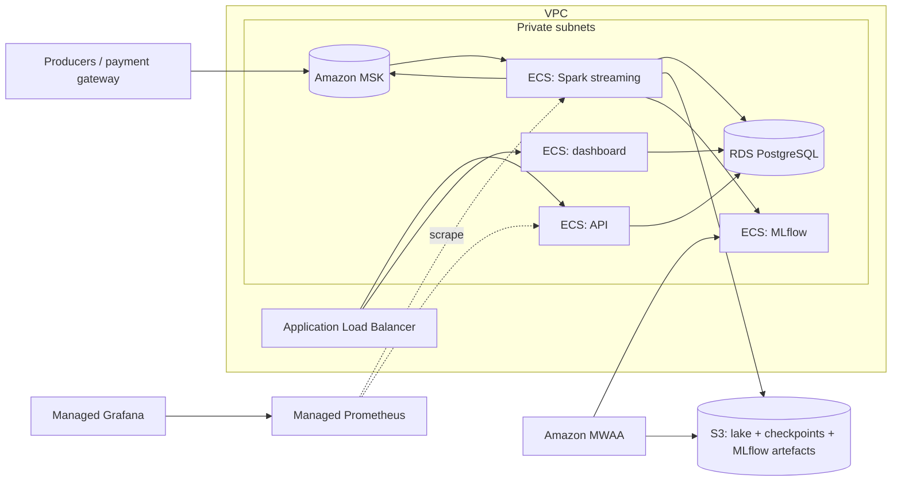

# Cloud deployment (AWS)

The platform is developed and tested locally with Docker Compose. This
document maps it onto AWS managed services; `infrastructure/` contains the
Terraform for it. **No component needs code changes to move** — every
connection is configured through environment variables, and the same five
container images run in both places.

> Status: designed and expressed as Terraform (`terraform validate` passes in
> CI), but not kept running in an AWS account — a 24/7 streaming stack is not
> free, and a documented, reproducible architecture is the goal of this phase.

## Mapping

| Local (docker compose) | AWS | Why this service |
| --- | --- | --- |
| Kafka (single KRaft broker) | **Amazon MSK** (3 brokers, one per AZ) | Managed, multi-AZ Kafka; SASL/SCRAM over TLS; same Kafka protocol, so producers and Spark only change connection settings |
| Spark container (`local[*]`) | **ECS Fargate** service running the Spark image (small volume) → **EMR on EKS / EMR on EC2** when volume grows | Structured Streaming is a long-running driver; one Fargate task is the cheapest way to run the same image, EMR adds executors when one machine is not enough |
| Parquet lake volume | **Amazon S3** lake bucket (`s3a://…/lake`), Glue Data Catalog + Athena for ad-hoc SQL | Durable, cheap, decoupled storage for history and retraining data |
| Spark checkpoints volume | **Amazon S3** (`s3a://…/checkpoints`) | S3 is strongly consistent; checkpoints survive task replacement |
| PostgreSQL | **Amazon RDS for PostgreSQL 16** (Multi-AZ in production) | Managed backups, patching, failover for the serving store |
| MLflow (SQLite + local artefacts) | MLflow on **ECS Fargate** with **RDS** backend store and **S3** artefact store (or SageMaker managed MLflow) | Shared tracking server and registry; artefacts in S3 |
| Airflow container | **Amazon MWAA** | Managed scheduler/webserver; the DAG is unchanged |
| API + dashboard containers | **ECS Fargate** behind an **Application Load Balancer** | Stateless services, horizontal scaling, health checks |
| Prometheus + Grafana | **Amazon Managed Service for Prometheus** + **Amazon Managed Grafana** | Same metrics and PromQL; dashboards import as-is |
| Images built locally | **Amazon ECR** | One repository per image, scanned on push |
| `.env` / compose credentials | **AWS Secrets Manager** | MSK SCRAM credentials and DB passwords injected into tasks |



## What changes per component (configuration only)

| Component | Variables |
| --- | --- |
| Producer, Spark, debug consumer | `KAFKA_BOOTSTRAP_SERVERS` (MSK SASL/SCRAM brokers), `KAFKA_SECURITY_PROTOCOL=SASL_SSL`, `KAFKA_SASL_MECHANISM=SCRAM-SHA-512`, `KAFKA_SASL_USERNAME`, `KAFKA_SASL_PASSWORD` (`producer/kafka_config.py`) |
| Spark | `LAKE_PATH=s3a://<bucket>/lake`, `CHECKPOINT_ROOT=s3a://<bucket>/checkpoints` — image built with `--build-arg WITH_S3=true` (adds `hadoop-aws` + AWS SDK v2); credentials from the ECS task role |
| Spark, API, Airflow | `POSTGRES_DSN` (RDS endpoint), `MLFLOW_TRACKING_URI` (internal ALB or service discovery name) |
| MLflow | `--backend-store-uri postgresql://…` (RDS), `--artifacts-destination s3://<bucket>/mlflow` |

A complete example lives in [`.env.cloud.example`](../.env.cloud.example).

## Network and security

* One VPC across two (or three) AZs: **private subnets** for MSK, RDS and all
  ECS tasks; **public subnets** only for the ALB and NAT gateway.
* Security groups allow exactly the flows above: tasks → MSK on 9096
  (SASL/SCRAM TLS), tasks → RDS on 5432, ALB → API/dashboard. Nothing in the
  private subnets is reachable from the internet.
* S3 bucket: public access blocked, server-side encryption, versioning;
  gateway VPC endpoint so lake traffic does not cross the NAT gateway.
* IAM task roles scoped to the lake bucket and the specific secrets;
  no static AWS keys in images or environment.

## Cost levers

The streaming path is always on, so the managed services that bill per hour
dominate: MSK brokers, MWAA, NAT gateway, RDS and the Spark task. For a demo
account:

* MSK Serverless or the smallest broker size, RDS `db.t4g.micro`, one Spark
  task, no Multi-AZ;
* run retraining from a scheduled ECS task instead of MWAA;
* `terraform destroy` when not demonstrating — everything is reproducible from
  code, and the lake data in S3 is kept separately.

Check current prices in the AWS Pricing Calculator before deploying.

## Deploy (outline)

```bash
cd infrastructure
terraform init
terraform apply -var="project=fraud-platform" -var="aws_region=eu-central-1"

# Push images to the ECR repositories created above
aws ecr get-login-password | docker login --username AWS --password-stdin <account>.dkr.ecr.<region>.amazonaws.com
docker build -f streaming/Dockerfile --build-arg WITH_S3=true -t <ecr>/fraud-platform/spark:1.0 . && docker push …
```

ECS services pick up the image tags from Terraform variables; MSK SCRAM
credentials and the RDS password are generated by Terraform and stored in
Secrets Manager.
