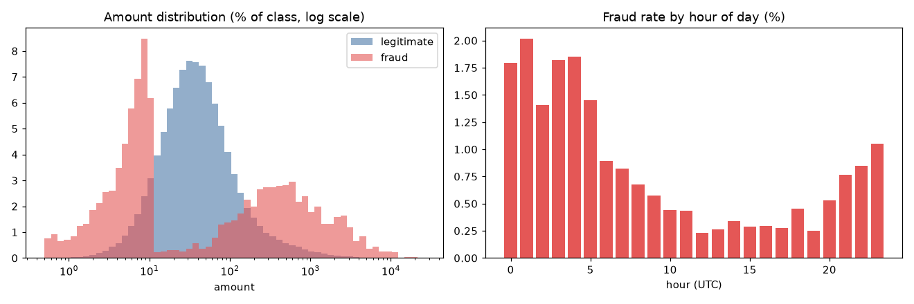
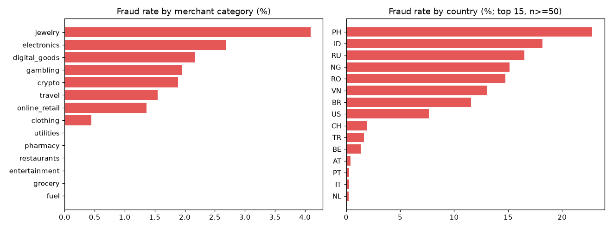

# Dataset and exploratory analysis

## Sources

| Source | Rows | Fraud | Used for |
| --- | --- | --- | --- |
| Synthetic simulator (`python -m ml.dataset`) | ~359k (3 days, 600 cards) | ~0.63 % | Training the platform model, streaming |
| ULB credit-card fraud, OpenML #1597 (`python -m ml.dataset --source public`) | 284,807 | 0.17 % | External benchmark of the model families |

The public dataset is the standard benchmark for card fraud, but its features
are anonymised PCA components (`V1..V28`) with no user, merchant, device or
country, so it cannot drive behavioural feature engineering. The platform
therefore trains on the simulator, whose event schema matches what flows
through Kafka, and uses the public dataset to sanity-check the modelling
approach on real data.

## How the simulator creates signal (and noise)

Fraud is injected as multi-transaction **scenarios**:

| Scenario | Share | Pattern |
| --- | --- | --- |
| `card_testing` | ~48 % of fraud tx | 3-8 tiny charges (0.50-9.99) at digital/online merchants within seconds, often from a new device, sometimes followed by one large purchase |
| `account_takeover` | ~29 % | New device, foreign country, 1-4 big-ticket purchases (electronics, jewelry, travel, crypto, gambling) |
| `stolen_card` | ~14 % | Home country, 2-5x usual spend at electronics/jewelry/clothing over 5-30 minutes |
| `subtle` | ~2 % | One purchase on the card holder's own device and country, 1-2.5x usual amount — practically indistinguishable |

Legitimate behaviour contains the confounders a real model faces: trips abroad
(30 % of them to the same countries fraud rings use), big-ticket purchases,
and new phones. No single attribute is a perfect fraud indicator.

## Observations

* **Amounts are bimodal for fraud**: card-testing micro-charges and big-ticket
  takeovers. The *raw* amount is a weak feature; amount **relative to the card
  holder's own history** is much stronger — motivating the behavioural
  features computed in the streaming layer.
* **Night-time fraud rate is ~3x the daytime rate**, because legitimate
  activity drops at night while fraud rings do not.

* Jewelry and electronics carry the highest fraud rates; everyday categories
  (grocery, fuel, pharmacy) almost none. Category is turned into a smoothed
  target-encoded **merchant risk** feature.
* Countries the fraud rings operate from show 10-25 % fraud rates, but
  legitimate travellers also transact there, so country is a risk factor, not
  a rule.

## Class imbalance

At ~0.6 % positives a model predicting "never fraud" is 99.4 % accurate, so
accuracy is not reported. Models are compared on **PR-AUC**, precision,
recall and F1 at an explicit decision threshold.
