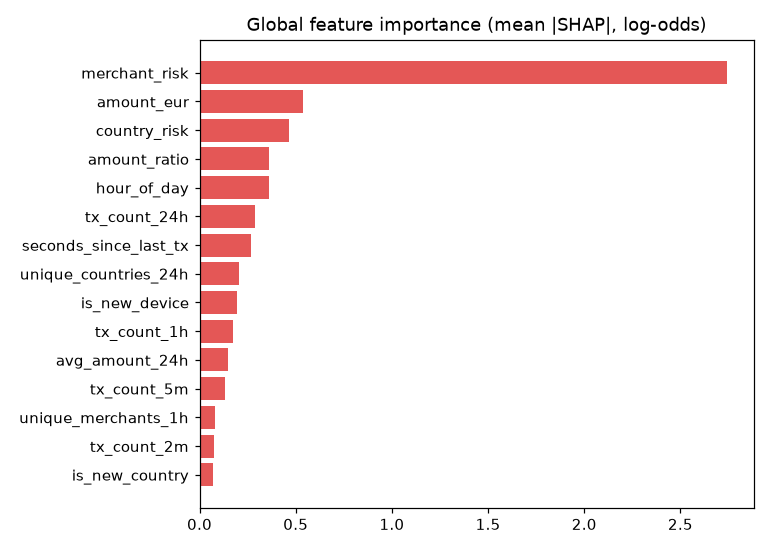

# Explainability

A score of 0.94 is not actionable on its own. An analyst reviewing an alert,
a customer disputing a block and a regulator auditing the system all ask the
same question: *why?*

## Per-transaction explanations

Every prediction carries **risk factors** computed from SHAP values:

```json
{
  "transaction_id": "tx_8e9b4bec8513",
  "fraud_probability": 0.998,
  "prediction": "FRAUD",
  "risk_factors": [
    "new device (device_96084ae47b)",
    "elevated fraud rate for transactions in BR (13.5%)",
    "very small amount (EUR 3.24)",
    "first transaction from BR"
  ]
}
```

How it works (`ml/explain.py`):

1. XGBoost computes exact **TreeSHAP** contributions natively
   (`booster.predict(dmatrix, pred_contribs=True)`) — no extra library, and
   cheap enough to run for every transaction in the stream.
2. Each contribution is the feature's push on the log-odds of fraud for *this*
   transaction. Contributions below 0.15 log-odds are ignored as noise.
3. The strongest positive pushes (max 4) are rendered with the feature value
   and context: `amount_ratio = 8.2` becomes "amount 8.2x higher than the
   customer's 24h average", `tx_count_2m = 5` becomes "5 transactions in the
   previous 2 minutes".
4. The raw top-5 contributions are stored alongside (`shap_top`) for audit.

Because the explanation is derived from the model's own attributions rather
than hand-written rules, it can never contradict the score.

## Global importance

`python -m ml.explain` (and every tracked training run, under
`explainability/` in MLflow) produces the mean |SHAP| per feature:



Merchant risk carries the most weight overall because it confidently *clears*
the bulk of everyday transactions (grocery, fuel, restaurants). Among the
behavioural features, amount ratio, history length and time since the last
transaction matter most — exactly the signals that distinguish a card holder
from someone else using their card.
