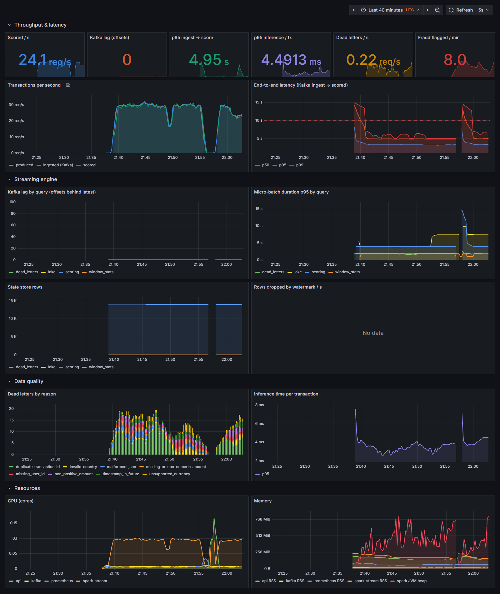

# Monitoring

Two different things are monitored, with different failure modes:

| | Infrastructure monitoring | ML monitoring |
| --- | --- | --- |
| Question | Is the pipeline healthy and fast? | Is the model still right for today's data? |
| Fails when | lag builds up, batches slow down, records get rejected | customer behaviour shifts, fraud patterns change |
| Signals | throughput, Kafka lag, latency, batch duration, state size, DLQ rate, CPU/memory | score distribution, fraud rate vs training, feature drift (PSI), serving version |

## Metrics

| Source | Endpoint | Highlights |
| --- | --- | --- |
| Spark driver (`streaming/metrics.py`) | `spark:9108/metrics` | `fraud_stream_scored_total{prediction}`, `fraud_stream_e2e_latency_seconds` (Kafka ingest → scored, per transaction), `fraud_stream_scoring_seconds_per_row`, `fraud_stream_kafka_offsets_behind_latest{query}`, `fraud_stream_batch_duration_seconds{query}`, `fraud_stream_state_rows`, `fraud_stream_rows_dropped_by_watermark_total`, `fraud_stream_dead_letters_total{reason}`, `fraud_model_score`, `fraud_model_fraud_rate`, `fraud_feature_psi{feature}`, `fraud_model_version_info` |
| Spark JVM (PrometheusServlet) | `spark:4040/metrics/prometheus` | driver heap, GC, executor metrics |
| API | `api:8000/metrics/` | requests and latency by route, online predictions |
| Producer (`--metrics-port 8001`) | `:8001/metrics` | events published |
| kafka-exporter | `kafka-exporter:9308` | topic/partition offsets → ingestion rate |

Query-level numbers (rates, lag, batch duration, state, watermark drops) come
from a `StreamingQueryListener`, i.e. from Spark's own progress reports;
per-transaction numbers (latency, scores) are observed in `foreachBatch`.
Spark Structured Streaming does not commit offsets to a Kafka consumer group,
so **lag is taken from the Kafka source's `maxOffsetsBehindLatest`** progress
metric rather than from consumer-group lag.

## Feature drift

At training time every feature's distribution is stored in the model spec as
decile bins (`ml/monitoring.py`). The driver keeps the last 5,000 scored
transactions and computes the **Population Stability Index** per monitored
feature after each batch:

```text
PSI = Σ (actual% − expected%) · ln(actual% / expected%)
< 0.1 stable · 0.1–0.25 moderate shift · > 0.25 significant drift
```

Monitored features are those that should be stationary over a few minutes
(`amount_eur`, `amount_ratio`, `merchant_risk`, `country_risk`). Time-of-day
and history-length features are excluded on purpose: a five-minute window
covers one hour of the day by construction, and every restart of the stream
starts from empty per-user state.

Example — the average transaction amount moves from EUR 91 in training to
EUR 180 in production:

```bash
python producer/producer.py --rate 30 --amount-drift 2.0 --metrics-port 8001
```

`fraud_feature_psi{feature="amount_eur"}` crosses 0.25 and the
`FeatureDrift` alert fires — the signal to investigate and, if the shift is
real, retrain (the Airflow DAG can be triggered on demand).

## Alerts (`monitoring/alerts.yml`)

| Alert | Condition |
| --- | --- |
| `StreamingLagHigh` | scoring query > 5,000 offsets behind for 2 min |
| `EndToEndLatencyHigh` | p95 ingest → score > 10 s for 5 min |
| `ScoringStalled` | transactions arriving, nothing scored for 3 min |
| `DeadLetterRateHigh` | > 5 % of records dead-lettered |
| `FeatureDrift` | any monitored feature PSI > 0.25 for 5 min |
| `FraudRateAnomalous` | predicted fraud rate > 5x the training fraud rate for 10 min |

## Dashboards

Grafana (http://localhost:3001, anonymous viewer; admin / admin) is
provisioned with two dashboards generated by
`monitoring/grafana/build_dashboards.py`:

* **Fraud Platform — Streaming**: throughput (produced vs ingested vs
  scored), end-to-end latency percentiles, lag and batch duration per query,
  state size, watermark drops, dead letters by reason, inference time, CPU
  and memory.
* **Fraud Platform — Model & Drift**: serving version, predicted vs training
  fraud rate, score distribution, PSI per feature with 0.1 / 0.25 thresholds,
  production vs training average amount, API traffic and latency.




The second screenshot shows a drift drill: normal traffic, then six minutes
with `--amount-drift 2.0` (average amount EUR 91 -> EUR 180, `amount_eur`
PSI 0.44, `FeatureDrift` alert pending), then normal traffic again. It also
shows the API `/health` p95 dropping from ~450 ms to ~10 ms after the model
holder stopped re-downloading artefacts on every refresh and only checks which
version is champion.
