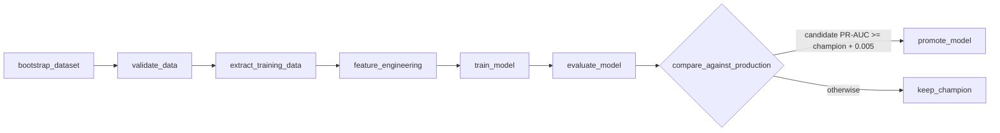

# Automated retraining (Airflow)

**Streaming and orchestration are different jobs.** Kafka and Spark process
every transaction continuously; Airflow runs the *batch* work around the
model on a schedule. Airflow never sits in the transaction path.

DAG: `airflow/dags/retrain_fraud_model.py` — every Sunday 03:00 UTC (and on
demand). UI: http://localhost:8080 (admin / admin, local only).

| Task | What it does | Output (run directory) |
| --- | --- | --- |
| `bootstrap_dataset` | Generates the base history on a fresh checkout | `data/raw/transactions.parquet` |
| `validate_data` | Data-quality gate: schema, row count, fraud-rate band, nulls, non-positive amounts, duplicate ids; reports analyst feedback counts from PostgreSQL. **Fails the run** on violation | `validation.json` |
| `extract_training_data` | Base history + the newest labelled period | `training.parquet` |
| `feature_engineering` | Chronological split, risk encodings on train only, behavioural features via the shared `UserState` | `train/valid/test.parquet`, `risk_tables.json` |
| `train_model` | XGBoost + logistic baseline; logs the run to MLflow and registers a new `fraud-detector` version (no alias) | `candidate/`, `train.json` |
| `evaluate_model` | Scores **candidate and current champion on the same, newest test split**, each with its own encodings and threshold | `evaluation.json` |
| `compare_against_production` | Branch: promote only if the candidate beats the champion by a margin (0.005 PR-AUC), so noise does not churn production | — |
| `promote_model` | Moves the MLflow `champion` alias. Spark and the API pick it up within a minute — no redeploy | `promotion.json` |

Design notes:

* Each task is one CLI step of `ml/retrain.py` that reads/writes files in a
  per-run directory, so tasks are idempotent, retryable and inspectable.
* The ML code runs in an **isolated virtualenv** inside the Airflow image
  (`/opt/ml-venv`), so pandas/XGBoost/MLflow versions never conflict with
  Airflow's own pinned dependencies.
* The label feed is **simulated**: real labels arrive from chargebacks and
  analyst decisions days to weeks later. Each run generates the next labelled
  period for the same card-holder population (seeded by the run id). Analyst
  decisions from the dashboard are counted in the validation report.

## Example runs

| Run | Candidate | Champion | Decision |
| --- | --- | --- | --- |
| `scheduled__2026-10-11` | v6, PR-AUC 0.758 | v4, 0.747 | **promoted** v6 |
| `manual__2026-10-19` | v7, PR-AUC 0.810 | v6, 0.808 | kept v6 (gain below 0.005 margin) |
